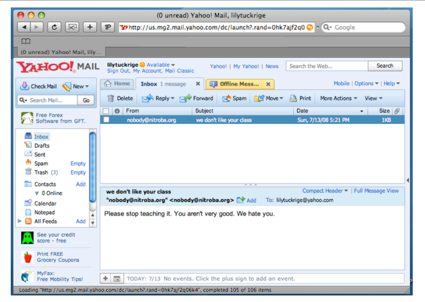
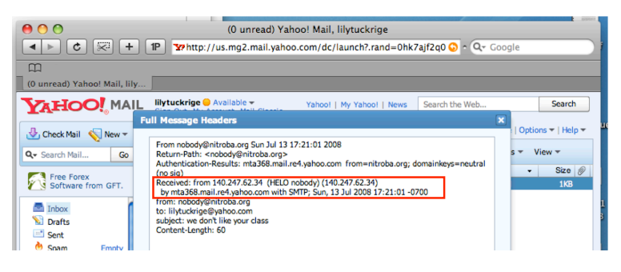
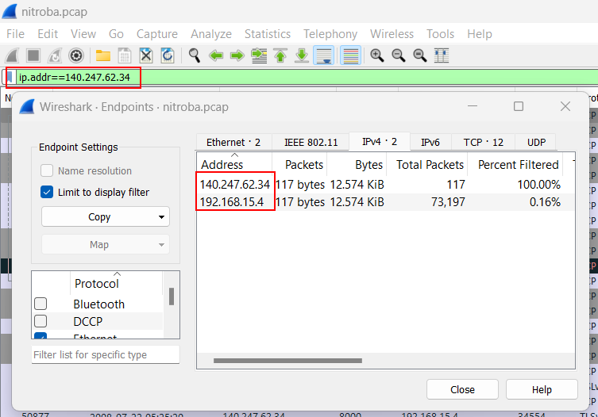
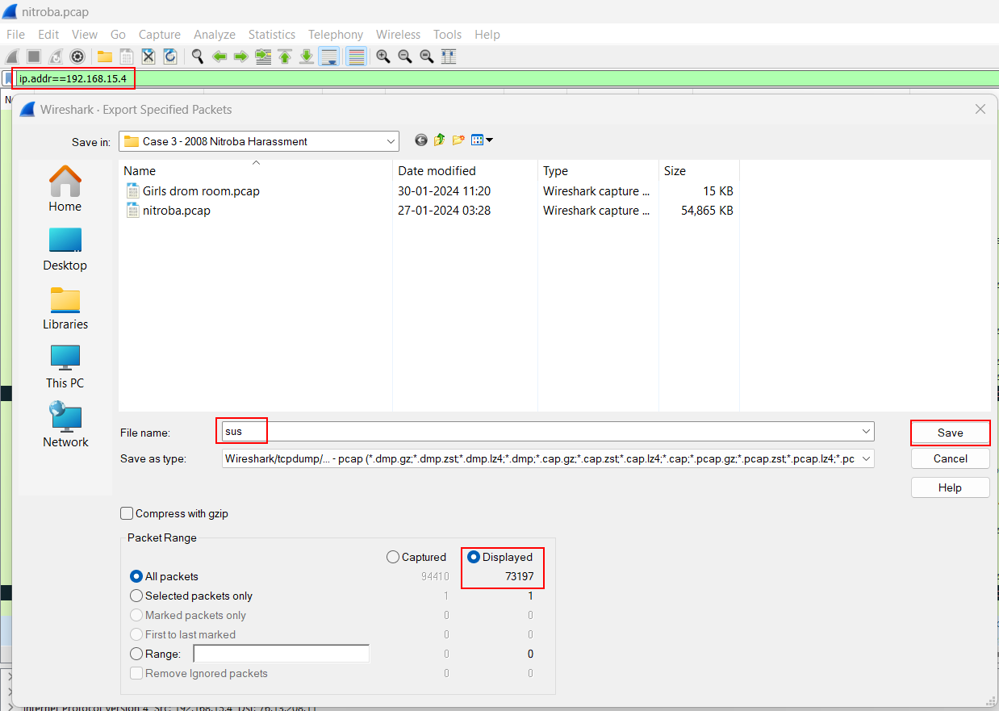
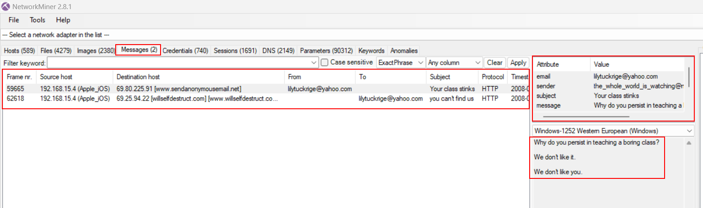
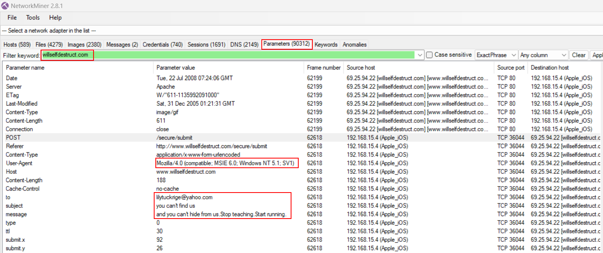
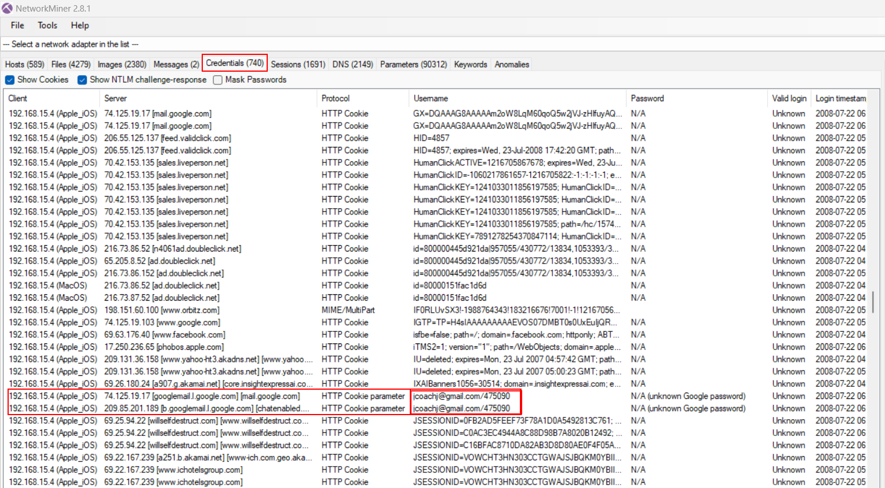

# Case-3-2008 Nitroba University Harassment Scenario - Testing website

---

- **You are a security administrator at the prestigious (and fictional) Nitroba State University.Nitroba’s IT department received an email from Lily Tuckrige, a teacher in the Chemistry Department. Tuckrige has been receiving harassing emails and she suspects that they are being sent by a student in her class Chemistry 109, which she is teaching this summer. The email was received at Tuckridge’s personal email account, [lilytuckrige@yahoo.com](mailto:lilytuckrige@yahoo.com). She took a screenshot of the web browser and sent it in.The system administrator who received the complaint wrote back to Tuckridge that Nitroba needed the full headers of the email message. Tuckridge responded by clicking the “Full message headers” button in Yahoo Mail and sent in another screen shot, this one with mail headers.The mail header shows that the mail message originated from the IP address 140.247.62.34, which is a Nitroba student dorm room. Three women share the dorm room. Nitroba provides an Ethernet connection in every dorm room but not Wi-Fi access, so one of the women’s friends installed a Wi-Fi router in the room. There is no password on the Wi-Fi.Because several email messages appear to come from the IP address, Nitroba decides to place a network sniffer on the ethernet port. All of the packets are logged. On Monday 7/21 Tuckridge received another harassing email. But this time instead of receiving it directly, the perpetrator sent it through a web-based service called “[willselfdestruct.com](http://willselfdestruct.com/).” The website briefly shows the message to Tuckridge, and then the website reports that the “Message Has Been Destroyed.”You have been given the screen shots, the packets that were collected from the Ethernet tap, and the Chem 109 roster. Your job is to determine if one of the students in the class was responsible for the harassing email and to provide clear, conclusive evidence to support your conclusion.**

---

## Evidences

- [pcap file](http://downloads.digitalcorpora.org/corpora/scenarios/2008-nitroba/nitroba.pcap) – about 60MB

---

## Information Gathered :

- University name: Nitroba University
- Staff name: Lily Tuckrige
- Staff's subject and class: Chemistry 109
- **Staff personal email address: [lilytuckrige@yahoo.com](mailto:lilytuckrige@yahoo.com)**
- Email's received:
    
    
    
    
    
- **IP of the sender: 140.247.62.34**
- The IP address is associated with girls dorm room and room members are:
    1. Alice
    2. **Barbara - Boyfriend kenny installed a Wi-Fi router in the room with no password**
    3. Candice
- **Host of selfdestruct mail : [willselfdestruct.com](http://willselfdestruct.com/)**
- Students list of the class:
Amy Smith
Burt Greedom
Tuck Gorge
Ava Book
Johnny Coach
Jeremy Ledvkin
Nancy Colburne
Tamara Perkins
Esther Pringle
Asar Misrad
Jenny Kant

---

## Questions

1. Map out the Nitroba dorm room network.

**There is only one host connected to the particular network
IP : 192.168.15.4**
    
    
    
2. Find who sent email to [lilytuckrige@yahoo.com](mailto:lilytuckrige@yahoo.com)
- Filtering the sus IP and loading in to network miner to mine info from the packets
    
    
    
- Look for a TCP flow that includes the hostile message
- Find information that can tie that message to a particular web browser.
    
    
    
    
    
1. Identify the other TCP connections that below to the attacker
2. Find information in one of those TCP connections that IDs the attacker.

    
    
    

**The username [jcoachj@gmail.com](mailto:jcoachj@gmail.com) is matches with Johnny Coach in class chemistry 109**

**Culprit**

```
Johnny Coach - jcoachj@gmail.com

```

---
